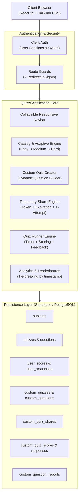

# Quizzr — Adaptive Learning & Custom Quiz Evaluation Platform

> A full-stack, responsive web application combining **curated adaptive subject progression**, **custom assessment authoring**, **temporary shareable links with single-attempt enforcement**, and **candidate feedback loops**.

---

## 📖 Executive Summary / Abstract

**Quizzr** is a modern assessment and learning management web application built with **React 19**, **Vite**, **Tailwind CSS**, **Clerk Authentication**, and **Supabase (PostgreSQL)**. 

Traditional quiz systems either present static questions without educational scaffolding or lack flexible sharing mechanisms for instructors and recruiters. Quizzr addresses both challenges:
1. **Adaptive Learning Pathway**: Enforces pedagogical progression in core computer science disciplines. Quizzes are stratified into *Easy*, *Medium*, and *Hard* tiers where advanced quizzes remain locked until candidates prove mastery on prerequisites (≥ 70% on Easy to unlock Medium; ≥ 50% on Medium to unlock Hard).
2. **Custom Assessment & Sharing Engine**: Empowers educators, team leads, and peers to compose bespoke quizzes with variable option counts and timers, generate temporary shareable URLs with strict expiration windows and single-attempt restrictions, and inspect granular candidate attempt breakdowns and question-level issue reports.

---

## 🛠️ Technology Stack & Architecture

### **Core Stack**
| Layer | Technology | Purpose |
| :--- | :--- | :--- |
| **Frontend Framework** | **React 19** (`react`, `react-dom`) | Modern component-based declarative UI |
| **Build Tool & Bundler** | **Vite 8** (`vite`, `@vitejs/plugin-react`) | Sub-second Hot Module Replacement (HMR) and optimized client production bundles |
| **Routing** | **React Router v7** (`react-router-dom`) | Client-side routing, protected routes, URL parameters |
| **Authentication** | **Clerk** (`@clerk/clerk-react`) | User session management, OAuth/email login, multi-session tokens |
| **Backend as a Service** | **Supabase** (`@supabase/supabase-js`) | Hosted PostgreSQL database, real-time queries, relational joins |
| **Styling & Design System** | **Tailwind CSS v3** + PostCSS + Autoprefixer | Utility-first CSS, dark glassmorphism, responsive grid & flexbox |
| **Icons** | **Lucide React** (`lucide-react`) | Consistent iconography across navigation, actions, and status badges |
| **Document Export** | **docx** | Programmatic document formatting capabilities |

---

### **System Architecture Diagram**

---

## 🌟 Comprehensive Feature Breakdown

### 1. Authentication, Identity & Session Security
- **Clerk Integration**: Seamless sign-in and sign-up flows with modal triggers on the landing page.
- **Protected Routing**: Critical user paths (`/dashboard`, `/create`, `/history`, `/subject/:id`, `/quiz/:id`, `/custom-quiz/:id`) are strictly guarded using `<SignedIn>` and `<SignedOut><RedirectToSignIn /></SignedOut>`.
- **Identity Attribution**: All quiz submissions, custom quiz creations, question reports, and share tokens are tagged with the verified user's Clerk ID and display name.

---

### 2. Adaptive Learning Progression System
Designed to ensure structured skill mastery, the adaptive progression engine dynamically calculates qualification criteria from the candidate's highest score.

#### **Target Subjects**
1. **Theory of Computation**
2. **Machine Learning**
3. **Operating System**
4. **Data Mining**

*(Other catalog subjects such as Java Programming and Computer Simulation & Modelling remain unrestricted).*

#### **Progression Criteria**
- **Tier 1 (Easy)**: Unlocked by default for all registered candidates.
- **Tier 2 (Medium)**: Unlocks only when the candidate achieves a score of **≥ 70%** on the corresponding *Easy* quiz of the same subject.
- **Tier 3 (Hard)**: Unlocks only when the candidate achieves a score of **≥ 50%** on the corresponding *Medium* quiz of the same subject.
- **Evaluation Mechanism**: Qualification uses the user's **highest historical score percentage** recorded in `user_scores` for that prerequisite quiz.
- **Two-Tier Enforcement**:
  - **Visual Card Guard ([`QuizCard.jsx`](src/components/QuizCard.jsx))**: Renders an amber "Locked" badge, disables the "Start Quiz" button, and displays the exact requirement note (e.g., *"Requires at least 70% score in the Easy quiz to unlock"*). Leaderboard buttons remain accessible.
  - **Route Guard ([`QuizRunner.jsx`](src/pages/QuizRunner.jsx))**: Intercepts direct URL navigation (e.g., manual navigation to `/quiz/:id`). If locked, stops quiz initialization, halts countdown timers, and presents a dedicated **Quiz Locked** interface displaying the candidate's current prerequisite percentage, target percentage, and a one-click button to launch the prerequisite quiz.

---

### 3. Quiz Difficulty Tagging & Descriptive Titling
- **Difficulty Badges**: Standard catalog quizzes display difficulty pill badges with semantic color-coding:
  - **Easy**: Emerald green (`bg-emerald-500/15 text-emerald-300 border-emerald-500/30`)
  - **Medium**: Amber yellow (`bg-amber-500/15 text-amber-300 border-amber-500/30`)
  - **Hard**: Rose red (`bg-rose-500/15 text-rose-300 border-rose-500/30`)
- **Descriptive Titles**: Converted legacy title strings into concise, academic topics:
  - *Data Mining*: **Data Mining Fundamentals**, **Classification & Clustering**, **Advanced Mining & Ensembles**
  - *Machine Learning*: **Machine Learning Basics**, **Supervised Models & Tuning**, **Neural Networks & Deep Learning**
  - *Operating System*: **OS Concepts & Architecture**, **Processes & Memory Management**, **Storage, Deadlocks & Kernels**
  - *Theory of Computation*: **Automata & Regular Languages**, **Context-Free Grammars & PDA**, **Turing Machines & Complexity**
- **Fallback Rule**: Quizzes without explicit level designations automatically receive the **Easy** badge.

---

### 4. Custom Assessment Authoring Engine
Located under the `/create` workspace, creators have unrestricted flexibility to design evaluations:
- **Quiz Metadata**: Title, optional description, and configurable timer limits.
- **Untimed Mode**: Toggle between strict timed quizzes (1 to 180 minutes) or **"Untimed (No limit)"** mode.
- **Flexible Options Builder**:
  - Unlimited questions per quiz.
  - Variable number of answer options per question (supports 2 for True/False, 3, 4, 5, or more options).
  - Radio button selector to designate the single correct answer key for automated grading.
  - Inline question and option deletion with minimum constraint validation.

---

### 5. Temporary Shareable Links & Single-Attempt Policy
Allows creators to distribute private quiz invitations to students or candidates:
- **Expiration Presets**: **1 Hour**, **6 Hours**, **24 Hours**, **3 Days**, **7 Days**, or **Custom Date & Time**.
- **Timezone-Aware Picker**: Custom date-time selection uses local browser time (`toLocalISOString`), dark scheme calendar styling, and future-timestamp validation.
- **Unique Share Tokens**: Generates non-guessable links format: `/quiz/shared/:shareToken`.
- **Token Lifecycle Management**: Creators can view all generated links with live expiration timestamps and revoke/delete them at any time.
- **Candidate Gate ([`SharedQuiz.jsx`](src/pages/SharedQuiz.jsx))**:
  - Validates share token and checks `expires_at > NOW()`.
  - Displays formatted "Quiz Invitation" preview card showing question count, time limit, and instructions.
  - If expired: Renders a dedicated notice displaying the exact expiration timestamp.
- **Strict Single-Attempt Enforcement**:
  - Candidates can attempt a shared quiz **only once**.
  - Dual-layer verification: verified via Supabase `custom_quiz_scores` and synchronized with client `localStorage`.
  - Re-attempting blocks the quiz and renders a score review summary card with a link to the leaderboard.

---

### 6. Interactive Quiz Runner Engine
Shared across standard catalog quizzes ([`QuizRunner.jsx`](src/pages/QuizRunner.jsx)) and custom quizzes ([`CustomQuizRunner.jsx`](src/pages/CustomQuizRunner.jsx)):
- **Real-Time Synchronized Timer**: Countdown timer with minutes and seconds display; pulses with red warning alerts when under 60 seconds.
- **Auto-Submission**: Automatically evaluates and finalizes answers when the timer reaches 00:00.
- **Dynamic Progress Bar**: Live visual percentage indicator reflecting question advancement.
- **Automated Grading**: Compares chosen answers against the database answer key, recording the total score and question-by-question responses.
- **Comprehensive Review**:
  - Results card with prominent gradient percentage score (`80%`, `100%`).
  - Answer review showing question text, correct answer highlighted in emerald, candidate choice highlighted in red (if incorrect), and confirmation markers.

---

### 7. Candidate Question Feedback & Reporting Loop
- **In-Review Flagging**: Candidates reviewing custom quiz results can click **"🚩 Report Question"** on any question.
- **Feedback Modal ([`QuestionReportModal.jsx`](src/components/QuestionReportModal.jsx))**: Allows candidates to describe typos, ambiguity, or disputed answer keys.
- **Creator Report Inspector ([`OwnerReportsModal.jsx`](src/components/OwnerReportsModal.jsx))**:
  - Aggregates feedback grouped by question.
  - Displays reporter name, submission timestamp, question text, and candidate comments.

---

### 8. Real-Time Leaderboards & Performance Analytics
- **Global Leaderboard ([`Leaderboard.jsx`](src/pages/Leaderboard.jsx))**:
  - Displays rankings for standard catalog quizzes.
  - **Tie-Breaking Logic**: Ranks by highest score descending; ties are broken by earliest completion timestamp (`completed_at ASC`).
  - Distinct rank presentation for top performers: 🥇 1st Place, 🥈 2nd Place, 🥉 3rd Place.
- **Custom Quiz Leaderboard ([`CustomQuizLeaderboard.jsx`](src/pages/CustomQuizLeaderboard.jsx))**:
  - Tracks candidate rankings for user-created quizzes.
- **Creator Attempts Analytics ([`OwnerAttemptsModal.jsx`](src/components/OwnerAttemptsModal.jsx))**:
  - Total attempts counter, class average score percentage, and highest recorded score.
  - Expandable candidate response inspector showing the exact option selected for every question.

---

### 9. Attempt History & Personal Progress
- **History Log ([`History.jsx`](src/pages/History.jsx))**:
  - Chronological audit log of all completed quizzes for the signed-in user.
  - Shows subject name, quiz title, difficulty badge, percentage score, score ratio, and timestamp.
- **Attempt Detail Inspector ([`AttemptResult.jsx`](src/pages/AttemptResult.jsx))**:
  - Accessible by clicking any historical attempt row.
  - Loads recorded responses and compares them against question answer keys for thorough post-exam revision.

---

### 10. Responsive Glassmorphic UI & Collapsible Navigation
- **Design System**: Modern dark theme with radial background glow effects, backdrop blur panels (`backdrop-blur-md`), translucent borders (`border-white/10`), and indigo/violet gradients.
- **Collapsible Mobile Navbar ([`Navbar.jsx`](src/components/Navbar.jsx))**:
  - Desktop view (`≥ 768px`): Sleek horizontal navbar with brand logo, nav links, and Clerk User profile.
  - Mobile view (`< 768px`): Compact bar featuring a hamburger menu button (`Menu` / `X` toggle).
  - Mobile Dropdown: Expands to full-width navigation links with icons (`Home`, `Create`, `History`) and active gradient pills. Auto-closes on link selection or route change.
- **Responsive Tables**: All 4-column data tables (Leaderboards and History) feature dedicated horizontal scroll containers (`overflow-x-auto min-w-[500px]`), ensuring clean rendering without column squishing on narrow mobile screens.

---

